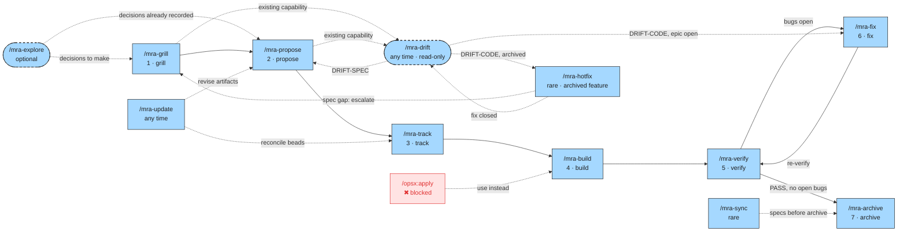
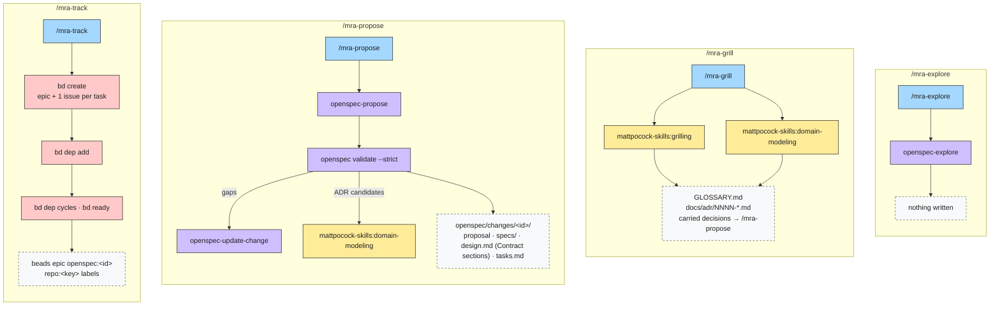
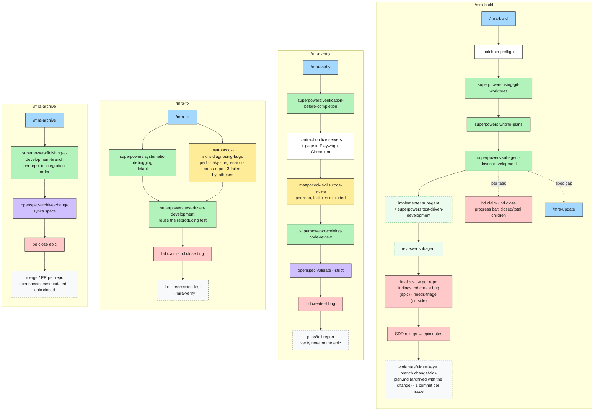
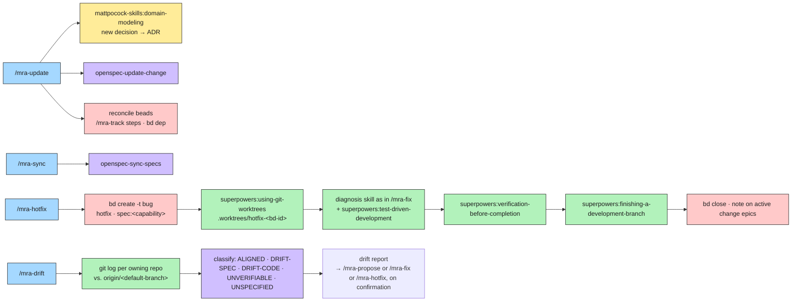
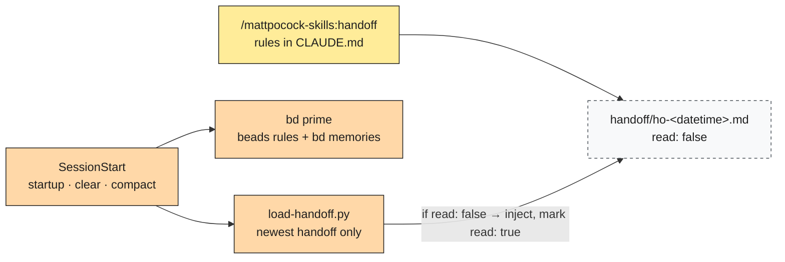

# mra-flow

The workflow of this orchestrator: which command to run in which phase, which skills each command calls, and what it leaves behind. Source of truth for the rules: `CLAUDE.md` (section *Workflow*) and `.claude/skills/mra-*`.

Colours: blue = `mra-*` command · green = superpowers · yellow = mattpocock-skills · purple = OpenSpec · red = beads (`bd`) · orange = hook · white dashed = artifact · white solid = plain step.

## 1. Phases

## 2. Skills called by each phase

### Discovery and specification

### Implementation, verification and integration

### Any time

## 3. Session continuity

