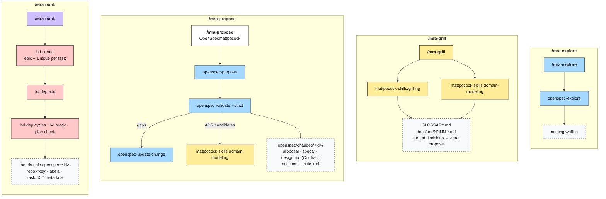
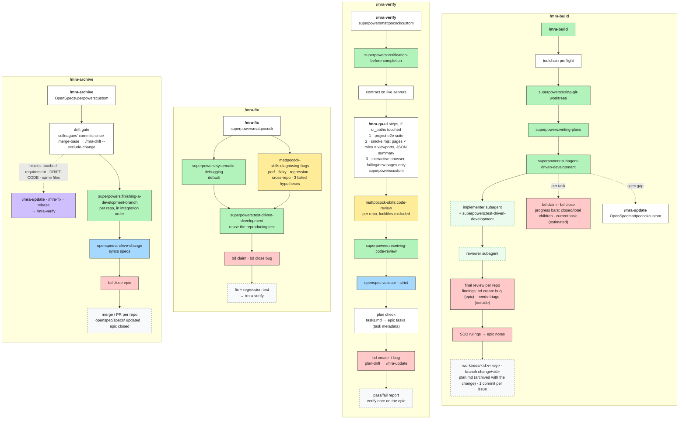
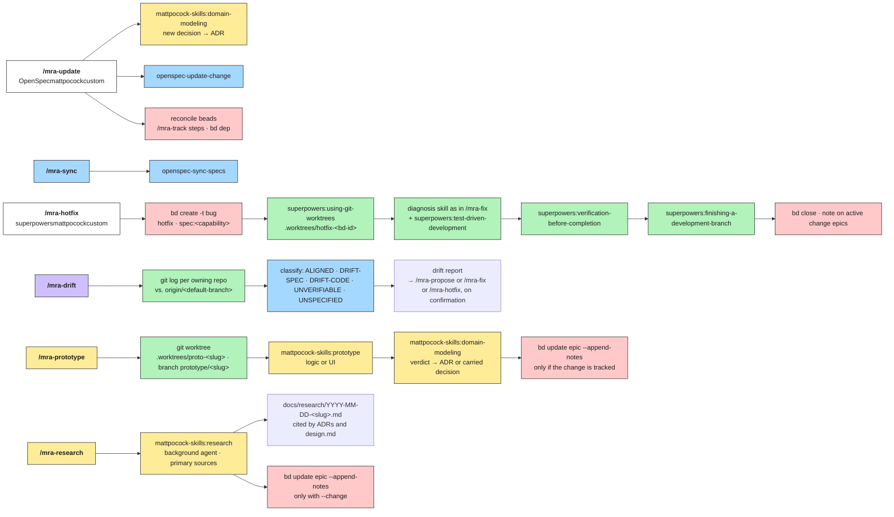
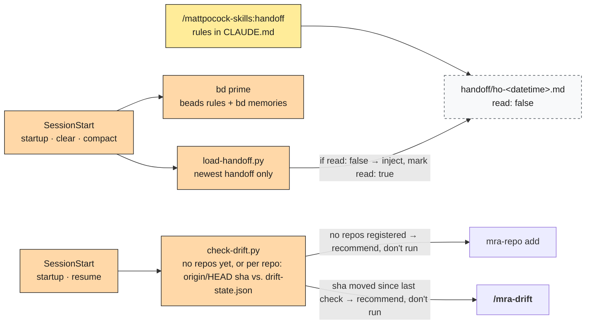

# mra-flow

The workflow of this orchestrator: which command to run in which phase, which skills each command calls, and what it leaves behind. Source of truth for the rules: `CLAUDE.md` (section *Workflow*) and `.claude/skills/mra-*`.

Colours: `mra-*` commands and the skills they call share the colour of the skill family — light blue = OpenSpec · green = superpowers · yellow = mattpocock-skills · purple = custom `mra-*` logic · red = beads (`bd`) · orange = hook · white dashed = artifact · white solid = plain step. A command that calls skills of one family has that family's colour; one that mixes families (or adds its own logic to them) is white with one band per family. In the phase diagram each command box lists the skills it calls through the Skill tool (prefixes `superpowers:` and `mattpocock-skills:` omitted). Dashed border = optional command.

| | Family | Commands |
|---|---|---|
|  | **OpenSpec** | `/mra-explore`, `/mra-sync` and the `openspec-*` skills |
|  | **superpowers** | `/mra-build` and the `superpowers:*` skills |
|  | **Matt Pocock** | `/mra-grill`, `/mra-prototype`, `/mra-research` and the `mattpocock-skills:*` skills |
|  | **custom** | `/mra-track`, `/mra-drift`: own logic only |
|  | **mixed** | white box, one band per family: `/mra-propose`, `/mra-fix` |
|  | **mixed + custom** | white box, one band per family: `/mra-update`, `/mra-verify`, `/mra-qa-ui`, `/mra-hotfix`, `/mra-archive` |
|  | **beads (`bd`)** | issue tracking steps |
|  | **hook** | SessionStart hooks |
|  | **blocked** | `/opsx:apply`: use `/mra-build` |

## 1. Phases

```mermaid
%%{init: {"themeCSS": ".bos,.bsp,.bmp,.bcu{white-space:nowrap} .t{font-size:1.25em;font-weight:700} .bos,.bsp,.bmp,.bcu{padding:2px 6px} .bos{background:#a5d8ff} .bsp{background:#b2f2bb} .bmp{background:#ffec99} .bcu{background:#d0bfff} .x{display:inline-block;padding:12px 20px;border:1px solid #e03131;background:linear-gradient(to top right,transparent calc(50% - 1.5px),#e03131 calc(50% - 1.5px),#e03131 calc(50% + 1.5px),transparent calc(50% + 1.5px)),linear-gradient(to bottom right,transparent calc(50% - 1.5px),#e03131 calc(50% - 1.5px),#e03131 calc(50% + 1.5px),transparent calc(50% + 1.5px)),#ffe3e3}", "flowchart": {"wrappingWidth": 400}}}%%
flowchart LR
    classDef phase fill:#d0bfff,stroke:#1e1e1e,color:#1e1e1e
    classDef oswrap fill:#a5d8ff,stroke:#1e1e1e,color:#1e1e1e
    classDef striped fill:#ffffff,stroke:#1e1e1e,color:#1e1e1e
    classDef stripedopt fill:#ffffff,stroke:#1e1e1e,stroke-dasharray:5 5,color:#1e1e1e
    classDef spwrap fill:#b2f2bb,stroke:#1e1e1e,color:#1e1e1e
    classDef mpwrap fill:#ffec99,stroke:#1e1e1e,color:#1e1e1e
    classDef optional fill:#d0bfff,stroke:#1e1e1e,stroke-dasharray:5 5,color:#1e1e1e
    classDef oswrapopt fill:#a5d8ff,stroke:#1e1e1e,stroke-dasharray:5 5,color:#1e1e1e
    classDef mpwrapopt fill:#ffec99,stroke:#1e1e1e,stroke-dasharray:5 5,color:#1e1e1e
    classDef blocked fill:transparent,stroke:transparent,color:#e03131

    explore(["<b class='t'>/mra-explore</b><br/>optional<br/><b>OpenSpec</b><br/>openspec-explore"]):::oswrapopt
    grill["<b class='t'>/mra-grill</b><br/>1 · grill<br/><b>Matt Pocock</b><br/>grilling<br/>domain-modeling"]:::mpwrap
    propose["<b class='t'>/mra-propose</b><br/>2 · propose<br/><span class='bos'><b>OpenSpec</b><br/>openspec-propose<br/>openspec-update-change</span><br/><span class='bmp'><b>Matt Pocock</b><br/>domain-modeling</span>"]:::striped
    track["<b class='t'>/mra-track</b><br/>3 · track"]:::phase
    build["<b class='t'>/mra-build</b><br/>4 · build<br/><b>superpowers</b><br/>using-git-worktrees<br/>writing-plans<br/>subagent-driven-development<br/>test-driven-development"]:::spwrap
    verify["<b class='t'>/mra-verify</b><br/>5 · verify<br/><span class='bsp'><b>superpowers</b><br/>verification-before-completion<br/>receiving-code-review</span><br/><span class='bmp'><b>Matt Pocock</b><br/>code-review</span><br/><span class='bcu'>custom</span>"]:::striped
    qaui(["<b class='t'>/mra-qa-ui</b><br/>verify step · or alone<br/><span class='bsp'><b>superpowers</b><br/>verification-before-completion</span><br/><span class='bcu'>custom</span>"]):::stripedopt
    fix["<b class='t'>/mra-fix</b><br/>6 · fix<br/><span class='bsp'><b>superpowers</b><br/>systematic-debugging<br/>test-driven-development</span><br/><span class='bmp'><b>Matt Pocock</b><br/>diagnosing-bugs</span>"]:::striped
    archive["<b class='t'>/mra-archive</b><br/>7 · archive<br/><span class='bos'><b>OpenSpec</b><br/>openspec-archive-change</span><br/><span class='bsp'><b>superpowers</b><br/>finishing-a-development-branch</span><br/><span class='bcu'>custom</span>"]:::striped
    update["<b class='t'>/mra-update</b><br/>any time<br/><span class='bos'><b>OpenSpec</b><br/>openspec-update-change</span><br/><span class='bmp'><b>Matt Pocock</b><br/>domain-modeling</span><br/><span class='bcu'>custom</span>"]:::striped
    sync["<b class='t'>/mra-sync</b><br/>rare<br/><b>OpenSpec</b><br/>openspec-sync-specs"]:::oswrap
    hotfix["<b class='t'>/mra-hotfix</b><br/>rare · archived feature<br/><span class='bsp'><b>superpowers</b><br/>using-git-worktrees<br/>systematic-debugging<br/>test-driven-development<br/>verification-before-completion<br/>finishing-a-development-branch</span><br/><span class='bmp'><b>Matt Pocock</b><br/>diagnosing-bugs</span><br/><span class='bcu'>custom</span>"]:::striped
    drift(["<b class='t'>/mra-drift</b><br/>any time · read-only"]):::optional
    proto(["<b class='t'>/mra-prototype</b><br/>stuck on design<br/><b>Matt Pocock</b><br/>prototype<br/>domain-modeling"]):::mpwrapopt
    research(["<b class='t'>/mra-research</b><br/>stuck on a fact<br/><b>Matt Pocock</b><br/>research"]):::mpwrapopt
    apply["<span class='x'>/opsx:apply<br/>blocked</span>"]:::blocked

    explore -. decisions to make .-> grill
    explore -. decisions already recorded .-> propose
    grill --> propose --> track --> build --> verify
    verify -- bugs open --> fix
    verify -. ui_paths touched .-> qaui
    qaui -. "bugs (qa-ui)" .-> fix
    fix -- re-verify --> verify
    verify -- "PASS, no open bugs" --> archive
    archive -. drift gate .-> drift
    update -. revise artifacts .-> propose
    update -. reconcile beads .-> track
    sync -. specs before archive .-> archive
    hotfix -. spec gap: escalate .-> grill
    hotfix -. fix closed .-> drift
    grill -. existing capability .-> drift
    propose -. existing capability .-> drift
    drift -. DRIFT-SPEC .-> propose
    drift -. DRIFT-CODE, epic open .-> fix
    drift -. DRIFT-CODE, archived .-> hotfix
    grill -. open design question .-> proto
    update -. open design question .-> proto
    proto -. verdict .-> grill
    proto -. verdict .-> update
    grill -. external fact .-> research
    propose -. external fact .-> research
    update -. external fact .-> research
    research -. cited note .-> grill
    research -. cited note .-> propose
    research -. cited note .-> update
    apply -. use instead .-> build
```

## 2. Skills called by each phase

### Discovery and specification

### Implementation, verification and integration

### Any time

## 3. Session continuity

